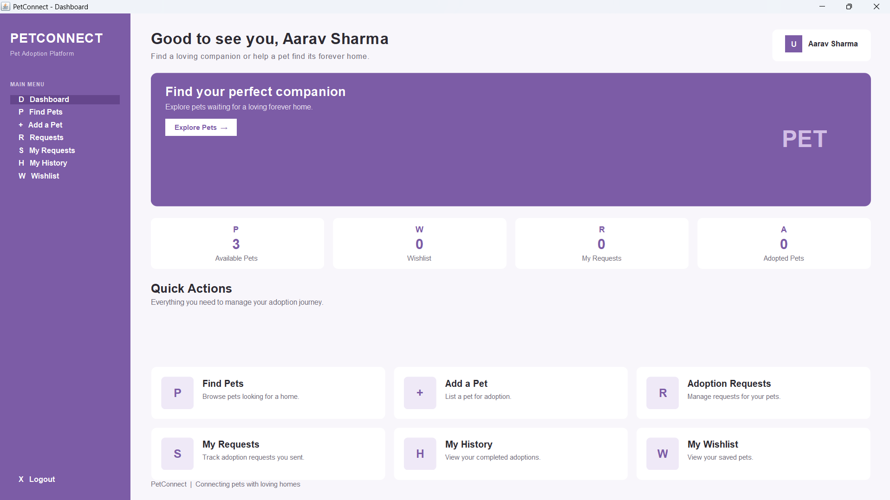

# 🐾 PetConnect

A Java-based desktop application for managing pet adoption and connecting pet owners with potential adopters.

## 📌 Project Overview

**PetConnect** is a desktop-based Pet Adoption Management System developed using **Java Swing, MySQL, and JDBC**.

The application allows users to register and log in, add pets for adoption, browse available pets, add pets to a wishlist, send adoption requests, manage received requests, view owner/adopter details, and track adoption history.

The project demonstrates **Object-Oriented Programming, inheritance, polymorphism, interfaces, collections, exception handling, multithreading, synchronization, JDBC, and database operations using DAO classes**.

## ✨ Features

* 🔐 User Registration and Login
* 🐶 Add pets for adoption
* 🔎 Browse available pets
* ❤️ Add pets to wishlist
* 📩 Send adoption requests
* ✅ Accept or reject adoption requests
* 👤 View owner/adopter details
* 📜 View adoption history
* 📊 Dashboard statistics
* 🔒 Prevent users from requesting adoption of their own pets
* 💾 Persistent MySQL database storage
* 🧵 Background database loading using `SwingWorker`

## 🛠️ Technologies Used

| Technology        | Purpose                  |
| ----------------- | ------------------------ |
| Java              | Application development  |
| Java Swing        | Graphical User Interface |
| MySQL             | Database                 |
| JDBC              | Database connectivity    |
| MySQL Connector/J | JDBC driver              |
| Git & GitHub      | Version control          |

## 🧱 Project Structure

```text
PetConnect/
├── src/
│   ├── model/
│   │   ├── Pet.java
│   │   ├── User.java
│   │   └── PetOwner.java
│   ├── interfaces/
│   │   └── Adoptable.java
│   ├── service/
│   │   ├── PetManager.java
│   │   └── AdoptionService.java
│   ├── gui/
│   │   ├── LoginFrame.java
│   │   ├── RegisterFrame.java
│   │   ├── DashboardFrame.java
│   │   ├── PetListFrame.java
│   │   ├── AddPetFrame.java
│   │   ├── AdoptPetFrame.java
│   │   ├── AdoptionRequestFrame.java
│   │   ├── AdoptionRequestsFrame.java
│   │   ├── AdoptionHistoryFrame.java
│   │   └── WishlistFrame.java
│   ├── dao/
│   │   ├── UserDAO.java
│   │   ├── PetDAO.java
│   │   ├── AdoptionDAO.java
│   │   ├── AdoptionRequestDAO.java
│   │   ├── WishlistDAO.java
│   │   └── DashboardStatsDAO.java
│   ├── util/
│   │   ├── DatabaseConnection.java
│   │   └── TestConnection.java
│   └── Test*.java
├── database/
│   └── petconnect.sql
├── lib/
│   └── mysql-connector-j-26.7.0.jar
├── screenshots/
├── RunPetConnect.bat
└── .gitignore
```

## 🗄️ Database

PetConnect uses a MySQL database named:

```text
petconnect
```

The database contains the following tables:

* `users`
* `pets`
* `adoptions`
* `adoption_requests`
* `wishlist`

The `pets` table uses `owner_id` to associate each pet with its owner.

### Database Setup

A complete database setup script is provided in:

```text
database/petconnect.sql
```

Import this SQL file into MySQL to create the database, tables, and safe fictional demo data.

### Demo Accounts

The SQL script includes fictional accounts for testing:

```text
Demo Owner
Email: owner@petconnect.demo
Password: demo123

Demo Adopter
Email: adopter@petconnect.demo
Password: demo123
```

## 🔌 Database Configuration

For security, the MySQL password is **not stored in the source code or GitHub repository**.

The application reads the database password from:

```text
PETCONNECT_DB_PASSWORD
```

On Windows PowerShell:

```powershell
setx PETCONNECT_DB_PASSWORD "YOUR_MYSQL_PASSWORD"
```

After setting the variable, restart the terminal or VS Code.

If required, update the database username or database settings in:

```text
src/util/DatabaseConnection.java
```

## ▶️ How to Run

### Requirements

* Java JDK 26 or a compatible Java version
* MySQL Server
* MySQL Workbench (recommended)
* MySQL Connector/J

### 1. Clone the repository

```bash
git clone https://github.com/divyansh-singh06/PetConnect.git
cd PetConnect
```

### 2. Set up the database

Import:

```text
database/petconnect.sql
```

into MySQL.

### 3. Configure the database password

Set the `PETCONNECT_DB_PASSWORD` environment variable:

```powershell
setx PETCONNECT_DB_PASSWORD "YOUR_MYSQL_PASSWORD"
```

Restart VS Code or the terminal after setting the variable.

### 4. Compile

From the project root:

```powershell
javac -cp ".;lib\mysql-connector-j-26.7.0.jar" src\model\*.java src\interfaces\*.java src\service\*.java src\dao\*.java src\util\*.java src\gui\*.java
```

### 5. Run

The project includes:

```text
RunPetConnect.bat
```

which can be used to launch the application.

## 🧩 Java Concepts Demonstrated

### Object-Oriented Programming

* **Encapsulation** through private fields and getters/setters
* **Inheritance** through `PetOwner extends User`
* **Polymorphism** through the `Adoptable` interface and `Pet` implementation
* **Interfaces** through `Adoptable`

### Collections & Generics

The project uses generic collections such as:

```java
ArrayList<Pet>
```

for managing application data.

### Multithreading

`SwingWorker` is used for background database operations so that database loading does not block the Swing user interface.

### Synchronization

The adoption service includes a `synchronized` method to demonstrate synchronization during adoption-related operations.

### DAO Pattern

Database operations are separated into dedicated DAO classes:

* `UserDAO`
* `PetDAO`
* `AdoptionDAO`
* `AdoptionRequestDAO`
* `WishlistDAO`
* `DashboardStatsDAO`

This separates database logic from the GUI and improves modularity.

## 📸 Application Screens

The repository contains screenshots demonstrating the main application features.

### Login


### Dashboard



### Add Pet


### Available Pets


### Wishlist


### Adoption Requests


### Adoption Request Accepted


### Owner Details


### Adoption History


## 👨‍💻 Author

**Divyansh Singh**

Computer Science Engineering with specialization in Data Science
Galgotias University

## 📄 License

This project was developed as an academic project.
